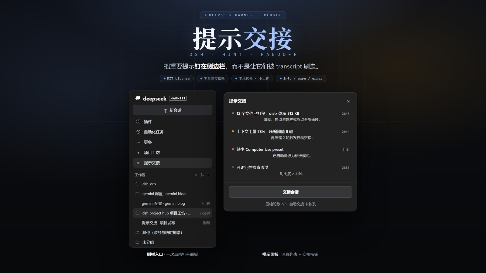
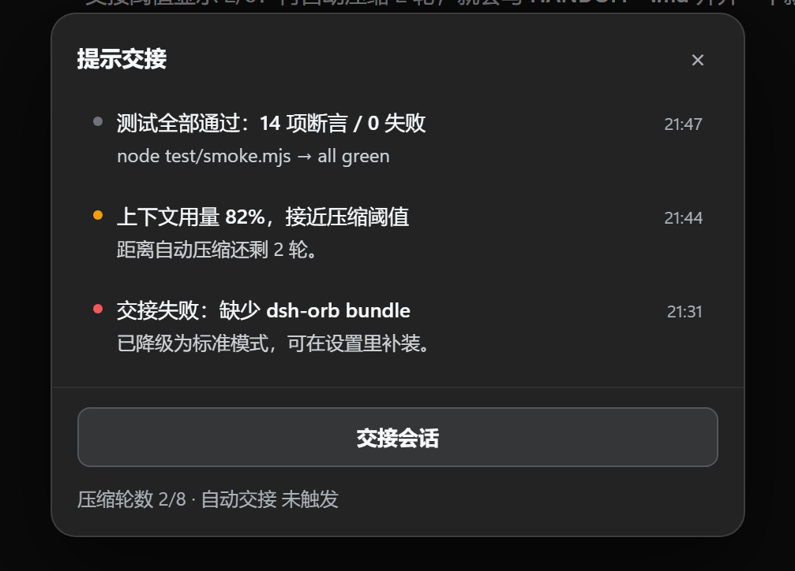
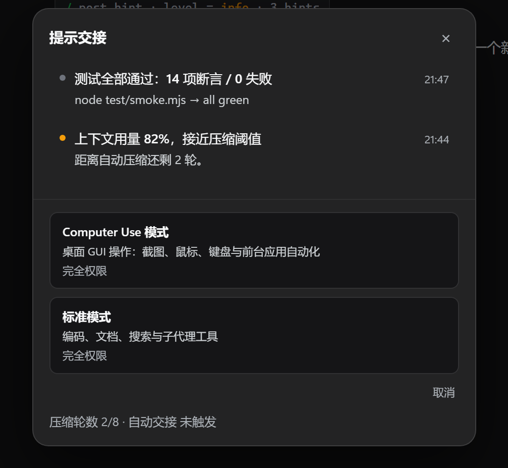
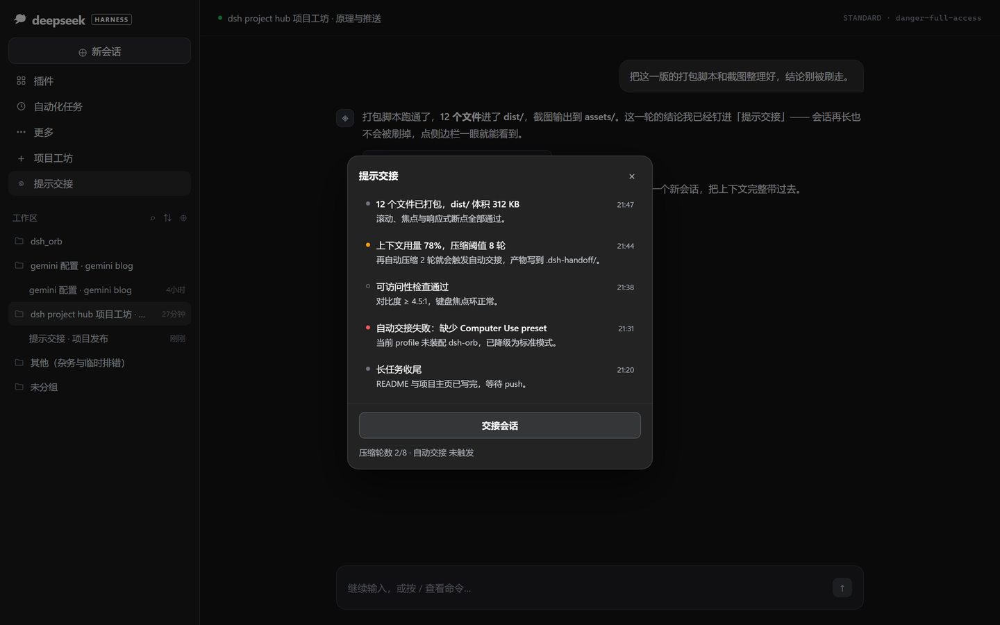
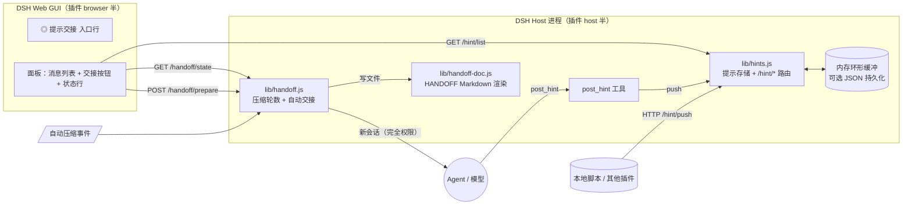

<div align="center">

# 提示交接 · DSH Task Resume

**把重要提示钉在侧边栏，而不是让它们被 transcript 刷走。**

*Pinned hints + one-click session handoff for DeepSeek Harness.*

[](./LICENSE)
[](./package.json)
[](#安装)
[](./package.json)
[](./package.json)
[](https://github.com/systemsssx/dsh-task-resume/stargazers)
[](https://github.com/systemsssx/dsh-task-resume/discussions)



</div>

> **一句话**：一个侧边栏入口，一块不会被刷走的提示面板，一颗把当前会话完整交给下一个会话的「交接会话」按钮。

> 仓库名 dsh-task-resume；插件包名与安装目录仍是 dsh-hint-handoff（git clone 时用仓库 URL 即可，目录名照旧）。

- **中文**：[为什么需要它](#为什么需要它) · [功能](#功能) · [安装](#安装) · [使用](#使用) · [面板交互](#面板交互) · [架构](#架构) · [FAQ](#faq)
- **English**：[TL;DR in English](#english-summary)

---

<a id="为什么需要它"></a>

## 为什么需要它

Agent 跑长任务时，「待会儿要处理」的信息通常只有两条出路：混进几十屏的 transcript，或者变成一枚 3 秒就消失的 toast。

两种都会漏。尤其是这三种东西：

| 你真正需要看见的 | 普通通知 / toast | 提示交接 |
|---|---|---|
| ⏳ **长任务收尾**：跑完了，但结论在里面 | 滚动找，或者重新问一遍 | 一条标题钉在面板最上面，点开侧边栏就在 |
| ⚠️ **需要你决策**：两个方案二选一，AI 停在那等 | 被下一条消息顶走 | `warn` 级别常驻，不会随会话滚动消失 |
| 🔴 **出错了但没停下来**：降级、跳过、部分失败 | 一闪而过，十分钟后才发现 | `error` 级别带红点，未读就一直亮着 |

提示交接把这些提示从「对话流」里拿出来，放进一块**独立、可滚动、带已读/未读状态的公告板**：

> 普通通知是「喊一声」，提示交接是「贴在冰箱上」。

它同时把「会话交接」也收进同一个面板：压缩轮数到了、或者你手动点一下，它会把当前会话写成一份 `HANDOFF-*.md`，并开一个**完全权限**的续接会话，从上一段的结论继续往下做。

---

<a id="功能"></a>

## 功能

| | 能力 | 一句话说明 |
|---|---|---|
| ◎ | **侧栏入口** | 原生「更多」下方、紧跟「项目工坊」的一行 `◎ 提示交接`，点击开/关面板；入口被别家插件占用时依次往下找空位，**永不覆盖别人的行** |
| 📌 | **提示面板** | 标题 + 正文 + 级别 + 时间，最新在上，最多保留 50 条（环形缓冲，可调） |
| 🎚️ | **三级语义** | `info` 灰点中性、`warn` 琥珀点注意、`error` 红点失败；已读后圆点变空心 |
| 🧠 | **`post_hint` 工具** | Agent 自己就能推提示：任务完成、需要决策、降级失败——不用你盯屏幕 |
| 🔌 | **本地 HTTP 面** | `/hint/list`、`/hint/push`、`/hint/read`、`/hint/clear`、`/hint/config`，任何本地脚本都能推提示 |
| 🔁 | **交接会话** | 面板按钮 → 选「Computer Use 模式 / 标准模式」→ 写交接文件 + 开全新会话续接 |
| ⏱️ | **自动交接** | 按真实的「已完成的自动压缩轮数」计数，达到 `threshold` 才触发；状态行显示真实 `x/y`，不写死 |
| 🔒 | **完全权限 + 完全本地** | 续接会话固定 `danger-full-access` + `approval: never`（面板里明示「完全权限」）；插件零第三方依赖、不联网、数据只在本机内存 / 可选 JSON |
| 🌱 | **可选持久化 / 播种** | `persistPath` 落盘提示列表；`seedFile` 从 `hints.json` / `HINTS.md` 预置一批提示 |
| 🧪 | **15 项冒烟测试** | 宿主挂载、入口插入与冲突、幂等、防闪、弹窗、模式交接、卸载，全都有断言 |

---

<a id="安装"></a>

## 安装

### 前置条件

| 依赖 | 要求 |
|---|---|
| DeepSeek Harness | 桌面版（Electron）、带 `webServer` / `tools` / `settings` 扩展点；Web 版亦可，但 Computer Use 模式需要桌面壳 |
| Node.js | **≥ 18**（纯 ESM，无第三方依赖） |
| 系统 | Windows / macOS / Linux |
| 权限 | 可读写 `~/.dsh/`（Windows：`%USERPROFILE%\.dsh\`） |

### 1 · 放进插件目录

```bash
# macOS / Linux
git clone https://github.com/systemsssx/dsh-task-resume.git ~/.dsh/plugins/dsh-hint-handoff

# Windows (PowerShell)
git clone https://github.com/systemsssx/dsh-task-resume.git "$env:USERPROFILE\.dsh\plugins\dsh-hint-handoff"
```

目录名必须是 `dsh-hint-handoff`（与 `package.json` 的 `name` 一致）。

### 2 · 装配到 profile

编辑 `~/.dsh/profiles/desktop/package.json`，把它加进 `bundles` 与 `dependencies`：

```jsonc
{
  "dsh": {
    "profile": {
      "bundles": [
        "@deepseek-ai/dsh-base",
        "@deepseek-ai/dsh-web-app",
        "dsh-hint-handoff"        // ← 新增
      ],
      "patchReload": "live"
    }
  },
  "dependencies": {
    "dsh-hint-handoff": "link:C:/Users/<you>/.dsh/plugins/dsh-hint-handoff"
  }
}
```

> `link:` 指向插件**真实目录**（Windows 示例）；插件已带 `cordis.patch.yml`，装进 `bundles` 后会自动叠加配置行，不需要手改 bundle 内部文件。

### 3 · 重启 DSH

重启 DSH（或触发 profile 热重载）后：

1. 左侧边栏「更多」下方出现 **`◎ 提示交接`**；
2. 点开就是提示面板；
3. 让 Agent 推一条提示试试：

```text
请用 post_hint 推一条 info：安装完成，面板可以用了。
```

### 4 · 可选配置

修改 `~/.dsh/plugins/dsh-hint-handoff/cordis.patch.yml` 里的 `config`：

| 字段 | 默认 | 含义 |
|---|---|---|
| `enabled` | `true` | 总开关 |
| `maxHints` | `50` | 最多保留多少条提示（1–500） |
| `threshold` | `1`（`index.js` 默认 8） | 完成多少次**自动压缩**后触发自动交接 |
| `outputDir` | `.dsh-handoff` | 交接文件写到哪里（相对会话 cwd 或绝对路径） |
| `archive` | `true` | 是否同时归档 `session.jsonl` |
| `digestEnabled` | `true` | 是否请当前模型生成交接摘要（失败则退回确定性事实） |
| `persistPath` | 空 | 提示列表落盘 JSON 路径；空 = 仅内存 |
| `seedFile` | 空 | 启动时读取的 `hints.json` / `HINTS.md`；空 = 关闭 |

> 优先级：`cordis.patch.yml` → DSH Settings 的 `hint-handoff` 命名空间 → `POST /hint/config` 的运行时覆盖。

---

<a id="使用"></a>

## 使用

### `post_hint` 参数

Agent 调用 `post_hint` 把一条提示推进面板：

| 参数 | 类型 | 必填 | 说明 |
|---|---|---|---|
| `title` | `string` | ✅* | 一行标题，列表里加粗显示（截断到 160 字） |
| `body` | `string` | ❌ | 补充说明：发生了什么、下一步做什么（截断到 1200 字） |
| `level` | `"info" \| "warn" \| "error"` | ❌ | 严重级别，默认 `info`；也可写 `warning` / `错误` 等别名，自动归一化 |

\* `title` 可省略但 `body` 必须存在：此时正文第一行会被提升为标题。

```jsonc
// 一次工具调用示例
{
  "title": "构建完成：12 个文件已打包",
  "body": "dist/ 体积 312 KB，滚动、焦点与响应式断点全部通过。",
  "level": "info"
}
```

返回：

```jsonc
{ "ok": true, "id": "hint-mh0x1c-1", "level": "info", "unread": 3, "total": 6 }
```

### 三种级别的实际效果

<div align="center">
  
  <br />
  <sub>未读圆点：<b>info</b> 灰 · <b>warn</b> 琥珀 · <b>error</b> 红；已读后圆点变为空心，标题、正文、时间保持同一排版</sub>
</div>

级别只决定左侧圆点的颜色，**不改变标题正文的排版**——面板始终是安静的深色列表，红点就是唯一的打扰。

### 交接会话

<div align="center">
  
  <br />
  <sub>点「交接会话」先选模式；两种模式都会在「完全权限」下启动新会话</sub>
</div>

| 模式 | 适合什么 |
|---|---|
| **Computer Use 模式** | 需要看屏幕、动鼠标键盘的 GUI 任务（preset `computer-use`） |
| **标准模式** | 编码、文档、搜索、子代理 |
| 两者共同点 | 新会话固定 `sandbox: danger-full-access` + `approval: never`；cwd 与会话状态由宿主继承 |

点下去之后：写 `HANDOFF-*.md`（默认 `.dsh-handoff/`）→ 归档 `session.jsonl` → 开一个全新会话，把交接文件作为第一句话。

### 本地 HTTP 接口

面板之外，任何本地脚本 / 其他插件都能推提示：

```bash
# 推一条
curl -s -X POST http://127.0.0.1:9760/hint/push \
  -H 'Content-Type: application/json' \
  -d '{"title":"部署完成","body":"prod 已切到新版本","level":"info"}'

# 读列表（含未读数与配置）
curl -s http://127.0.0.1:9760/hint/list

# 全部标记已读
curl -s -X POST http://127.0.0.1:9760/hint/read -H 'Content-Type: application/json' -d '{"all":true}'

# 交接状态（压缩轮数 x/y）
curl -s http://127.0.0.1:9760/handoff/state
```

> 端口以你本机 DSH Web GUI 实际监听为准（默认 `9760`；插件会优先走宿主注入的基址）。

---

<a id="面板交互"></a>

## 面板交互

<div align="center">
  
  <br />
  <sub>面板叠在 DSH 会话之上：消息列表 + 交接按钮 + 状态行；侧栏入口在「项目工坊」之后</sub>
</div>

| 操作 | 结果 |
|---|---|
| 点侧栏 `◎ 提示交接` | 打开 / 关闭面板 |
| `Esc` | 先收起模式选择，再关闭面板 |
| 点遮罩 / 右上角 `×` | 关闭面板 |
| 点「交接会话」 | 展开「Computer Use 模式 / 标准模式」两项（均标注完全权限） |
| 选模式 | 立即 POST `/handoff/prepare`，状态行显示「交接中…」→「交接完成 · 时间 · 文件名」 |
| 状态行 | 常驻显示真实数据：`压缩轮数 2/8 · 自动交接 未触发` / `已触发（12:04）` / `已关闭` |
| 未读提示 | 圆点实心；点开面板后由宿主标记已读，圆点变空心 |

**稳定性约定**（都写进了测试）：

- 入口行插入是**幂等**的：位置正确时零 DOM 写入，不会自己触发自己的监控器；
- 入口消失才用 120ms 防抖重挂，没有 `setInterval` / rAF 高频重扫；
- 克隆原生行时剥掉 `_wide` 等纯动画类，所以不会每秒重放淡入（历史「闪烁」根因）；
- 弹窗只在打开时轮询（1–2s），内容没变就不写 DOM。

---

<a id="架构"></a>

## 架构



**两半结构**（合并自 `dsh-hint-ball` 与 `dsh-auto-handoff`，两者状态、路由、工具互不干扰）：

```text
dsh-hint-handoff/
├─ cordis.patch.yml      profile bundle patch（插入 id=hint-handoff 的配置行）
├─ package.json          纯 ESM，无 dependencies；dsh.bundle / dsh.client 声明
├─ lib/
│  ├─ index.js           Cordis 入口（name / version / Config / apply）
│  ├─ hints.js           host：/hint/* 路由 + post_hint 工具
│  ├─ hint-store.js      数据模型（归一化、环形缓冲、已读、seed/persist 格式）
│  ├─ handoff.js         host：压缩轮数统计 + 自动交接 + /handoff/* + handoff_now
│  ├─ handoff-doc.js     交接 Markdown 渲染（确定性事实 + 可选模型摘要）
│  └─ client.js          browser：侧栏入口行 + 面板（原生 DOM，无 React/Bundler）
├─ locale/zh.json, en.json
└─ test/smoke.mjs        15 项冒烟测试
```

一条提示的数据契约始终是：

```jsonc
{ "id": "hint-…", "title": "…", "body": "…", "level": "info|warn|error", "ts": 1765112345678, "source": "tool", "read": false }
```

---

<a id="faq"></a>

## FAQ

<details>
<summary><b>装好后侧边栏没有「◎ 提示交接」？</b></summary>

1. 确认 profile 的 `bundles` 里有 `dsh-hint-handoff`，`dependencies` 里有对应的 `link:`；
2. 确认目录名与 `package.json` 的 `name` 完全一致；
3. 完全重启 DSH（不是只刷新页面）；
4. 打开 DevTools 看 `#dhh-nav-row` 是否存在——被别家插件占了位置时它会往下找空位，但不会消失。
</details>

<details>
<summary><b>面板里一条提示都没有？</b></summary>

空态是「暂无提示，安静一下。」——说明插件正常，只是还没有人 push。让 Agent 调一次 `post_hint`，或 `curl` 一下 `/hint/push`。
</details>

<details>
<summary><b>提示会不会丢？默认只在内存里。</b></summary>

会。重启 DSH 后提示列表清空。需要保留就设 `persistPath`（如 `.dsh-hints.json`），插件会在每次变更后 250ms 防抖落盘。
</details>

<details>
<summary><b>`warn` 的圆点为什么是琥珀色，而不是黄色文字？</b></summary>

面板刻意保持安静：级别只体现在圆点颜色上，标题正文永远是同一套排版。红点、琥珀点就是全部「颜色预算」。
</details>

<details>
<summary><b>自动交接什么时候触发？为什么状态行是 2/8？</b></summary>

只统计**已完成的自动压缩轮数**（手动 `/compact` 不计）。达到 `threshold` 才触发；状态行显示真实计数 `x/y`，不会写死。
</details>

<details>
<summary><b>「交接会话」点了没反应 / 报「代理仍在忙」？</b></summary>

交接只在安全时机执行：当前回合结束、没有未返回的工具调用、没有压缩在进行。等一拍再点；错误会显示在状态行，不会静默失败。
</details>

<details>
<summary><b>Computer Use 模式不见了？</b></summary>

这是预期降级：当前 profile 没有提供 `computer-use` preset 的 bundle（例如 `dsh-orb`）。补装后重启即可出现，不会报错、不会崩 UI。
</details>

<details>
<summary><b>会联网吗？会上传我的提示吗？</b></summary>

不会。插件零第三方依赖、没有网络请求，数据只在本机内存 / 你指定的 JSON 文件里。
</details>

---

## 测试

```bash
npm test        # node test/smoke.mjs —— 15 项全绿
npm run check   # 六个 lib 文件语法自检
```

| 覆盖 | 断言 |
|---|---|
| 宿主挂载 | bundle 注册、portal、隐藏弹窗、侧栏入口行 |
| 入口稳定性 | 插在「项目工坊」之后、冲突时找空位、幂等、无写入防闪、被删自愈 |
| 弹窗 | 打开、真实状态行 `压缩轮数 3/8 · 已触发 12:04`、空态、三种状态文案 |
| 交接 | 模式列表、完全权限标注、选模式后 POST 并更新状态行 |
| 卸载 | 只移除自己的节点，别家插件行原样保留 |

---

## 路线图

- [ ] 🗂️ 按项目分组提示（把 `.dsh-hub` 的项目上下文带进面板）
- [ ] 🔎 面板内搜索 / 过滤 level
- [ ] ⌨️ 快捷键（`Ctrl+Shift+H` 开面板）
- [ ] 🌐 `en-US` 完整文案（目前只有 locale 元信息）
- [ ] 📤 导出提示列表为 Markdown / HTML

---

<a id="star"></a>

## ⭐ Star 支持

<div align="center">

**如果它帮你少漏掉一条重要提示——**

**点个 ⭐ Star，就是继续做下去最直接的动力。**

[](https://github.com/systemsssx/dsh-task-resume/stargazers)
&nbsp;
[](https://github.com/systemsssx/dsh-task-resume/fork)

<sub>Fork 之后欢迎把改动推回来：错别字、新策略、真机踩坑都收。</sub>

</div>

---

## 交流与反馈

| 我想… | 去哪儿 | 请带上 |
|---|---|---|
| ❓ 提问 / 讨论用法 | **[Discussions](https://github.com/systemsssx/dsh-task-resume/discussions)** | 你的 DSH 版本 + 面板截图（记得脱敏） |
| 🐛 报 Bug | **[Issues](https://github.com/systemsssx/dsh-task-resume/issues)** | 复现步骤、期望 vs 实际、DevTools 报错 |
| 💡 提需求 | **[Issues · Feature](https://github.com/systemsssx/dsh-task-resume/issues/new)** | 使用场景 + 现在卡在哪 |
| 🛠️ 提 PR | **[Pull Request](https://github.com/systemsssx/dsh-task-resume/compare)** | 改动说明 + `npm test` 输出 |

> 发帖别贴 token / 真实绝对路径 / 用户名，用 `<你的工作区>`、`<项目>` 占位。

---

## English summary

**DSH Task Resume** is a sidebar plugin for DeepSeek Harness that turns transient notifications into pinned, persistent hints — and adds a one-click session handoff.

- Sidebar entry `◎ 提示交接` opens a dark panel with a scrollable hint list, a handoff button, and a live status line.
- The agent publishes hints through the `post_hint` tool (`title`, optional `body`, `level` = `info` / `warn` / `error`); local scripts can `POST /hint/push`.
- Hints keep unread/read state, a 50-item ring buffer, and optional JSON persistence.
- The handoff button writes a `HANDOFF-*.md`, archives `session.jsonl`, and starts a fresh session with full access — either "Computer Use" (GUI) or "standard" (coding) mode.
- Automatic handoff triggers on completed compaction rounds against a real `x/y` threshold, not a hard-coded value.
- Zero third-party dependencies, fully local, MIT licensed.

Install: clone into `~/.dsh/plugins/dsh-hint-handoff`, add it to your profile `bundles` + `dependencies`, restart DSH.

---

## License & 致谢

[MIT License](./LICENSE) © 2026 systemsssx

感谢 [DeepSeek Harness](https://github.com/deepseek-ai) 提供的 Electron 外壳、Cordis 插件管线与 Agent preset 扩展点；
本插件由两个本地插件 `dsh-hint-ball` 与 `dsh-auto-handoff` 合并而来，感谢它们打下的底子。

<div align="center">
<br />
<sub>给那些会把工作交给 AI，也会交给下一个人的人。◎</sub>
</div>
